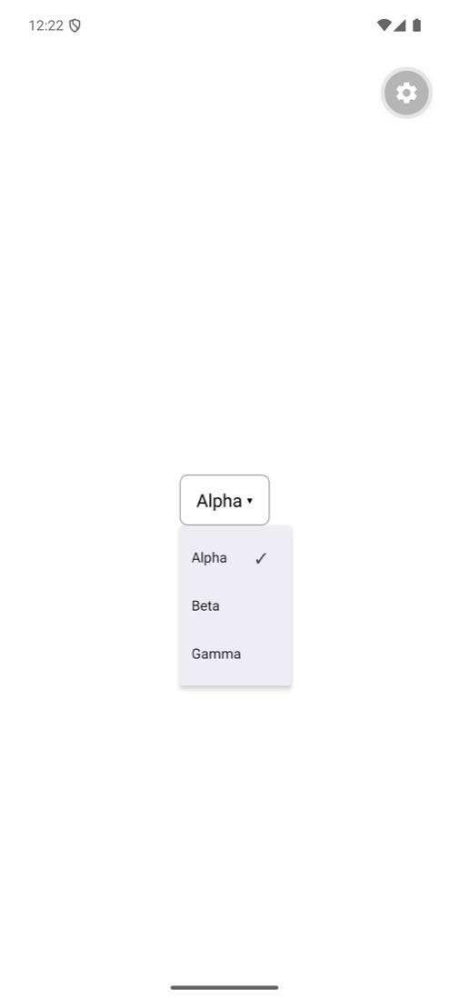

# @expo/ui community `MenuView` on Android: a selected action shows a trailing "✓" text

Minimal reproduction for an `@expo/ui` bug.

The docs for `@expo/ui/community/menu` say that an action with `state: 'on'` shows "a **leading** checkmark" ([docs](https://docs.expo.dev/versions/latest/sdk/ui/drop-in-replacements/menu/#toggle-items-with-checkmarks)).
On iOS the system menu does this. On Android the selected action shows a plain `✓` text character in the **trailing** slot, with no highlighted container.

| Android (this repro, Expo Go SDK 58, `@expo/ui` 58.0.28)        |
| --------------------------------------------------------------- |
|  |

## Run it

```sh
npm install
npx expo start --android   # Expo Go
```

Open the app and tap **Alpha ▾**.

## Versions

- `expo` ~58.0.25
- `@expo/ui` ~58.0.28
- `react-native` 0.88.1

## Where it comes from

[`packages/expo-ui/src/community/menu/MenuView.android.tsx`](https://github.com/expo/expo/blob/8d5bef561/packages/expo-ui/src/community/menu/MenuView.android.tsx#L144) draws the check as text:

```tsx
{
  state === "on" && (
    <DropdownMenuItem.TrailingIcon>
      <ComposeText>✓</ComposeText>
    </DropdownMenuItem.TrailingIcon>
  );
}
```
